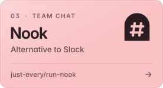
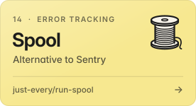

<a href="https://justevery.com">
  <picture>
    <source media="(prefers-color-scheme: dark)" srcset="assets/banner-dark.webp">
    <source media="(prefers-color-scheme: light)" srcset="assets/banner-light.webp">
    
  </picture>
</a>

<p align="center">
  <b>High-quality, open-source alternatives to the software you rent.</b><br>
  100% free and MIT licensed. <a href="https://justevery.com"><b>justevery.com&nbsp;→</b></a>
</p>

## Pick your replacement.

Fourteen products so far, each one an alternative to software you're probably paying for.

<p align="center">
<a href="https://github.com/just-every/run-uptime"></a>
<a href="https://github.com/just-every/run-happytohelp"></a>
<a href="https://github.com/just-every/run-nook"></a>
<a href="https://github.com/just-every/run-lamp"></a>
<a href="https://github.com/just-every/run-cradle"></a>
<a href="https://github.com/just-every/run-vector"></a>
<a href="https://github.com/just-every/run-slate"></a>
<a href="https://github.com/just-every/run-pencil"></a>
<a href="https://github.com/just-every/run-orbit"></a>
<a href="https://github.com/just-every/run-mango"></a>
<a href="https://github.com/just-every/run-dial"></a>
<a href="https://github.com/just-every/run-penny"></a>
<a href="https://github.com/just-every/run-oncall"></a>
<a href="https://github.com/just-every/run-spool"></a>
</p>

<p align="center"><b>Homepages:</b> <a href="https://run-uptime.com">Uptime</a> · <a href="https://run-nook.com">Nook</a> · <a href="https://run-cradle.com">Cradle</a> · <a href="https://run-slate.com">Slate</a> · <a href="https://run-pencil.com">Pencil</a> · <a href="https://run-mango.com">Mango</a> · <a href="https://run-penny.com">Penny</a> · <a href="https://run-oncall.com">Oncall</a> · <a href="https://run-spool.com">Spool</a></p>

## Run one yourself.

Install the command once, then clone a product and start it.

```sh
npx -y @runeditrun/rer cli install
git clone https://github.com/just-every/run-uptime
cd run-uptime && rer dev
```

It sets up a local owner and prints a link that opens the app, signed in. Swap `run-uptime` for any repo above. No npm? This installs the same command:

```sh
curl -fsSL https://runeditrun.com/install.sh | sh
```

Issues, pull requests and collaborators are welcome on every repo.

## Also from Just Every.

- **[Every Code](https://github.com/just-every/code)**: command-line coding agent, a fork of OpenAI's Codex CLI. Apache-2.0.
- **[Ensemble](https://github.com/just-every/ensemble)**: one interface to all the major LLMs. MIT.
- **[Task](https://github.com/just-every/task)**: reflective task execution on top of Ensemble. MIT.
- **[Magi](https://github.com/just-every/magi)**: orchestrates Tasks with a persistent chain of thought. MIT.
- **[Search](https://github.com/just-every/search)**: queries several search providers at once. MIT.
- **[Crawl](https://github.com/just-every/crawl)**: turns pages and sites into clean Markdown. MIT.
- **[Code Context](https://github.com/just-every/code-context)**: maps a repository's architecture and history for coding agents. MIT.
- **[Benchmark](https://github.com/just-every/benchmark)**: compares models and features on Ensemble and Task. MIT.
- **[MCP tools](https://github.com/orgs/just-every/repositories?q=mcp)**: servers for screenshots, reading websites, deep search and tasks. MIT.

<br>

<p align="center">
  <a href="https://justevery.com"></a>
</p>

<p align="center">More volumes on the way. <a href="https://justevery.com/#suggest">Tell us what to build next&nbsp;→</a></p>
